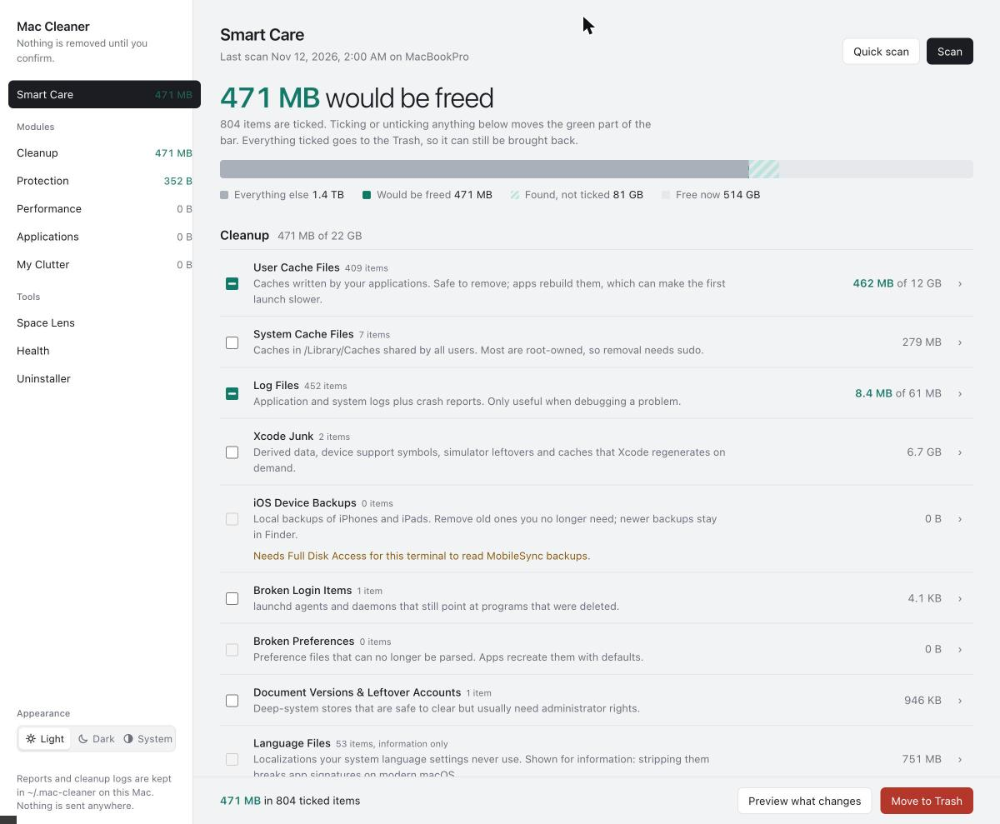
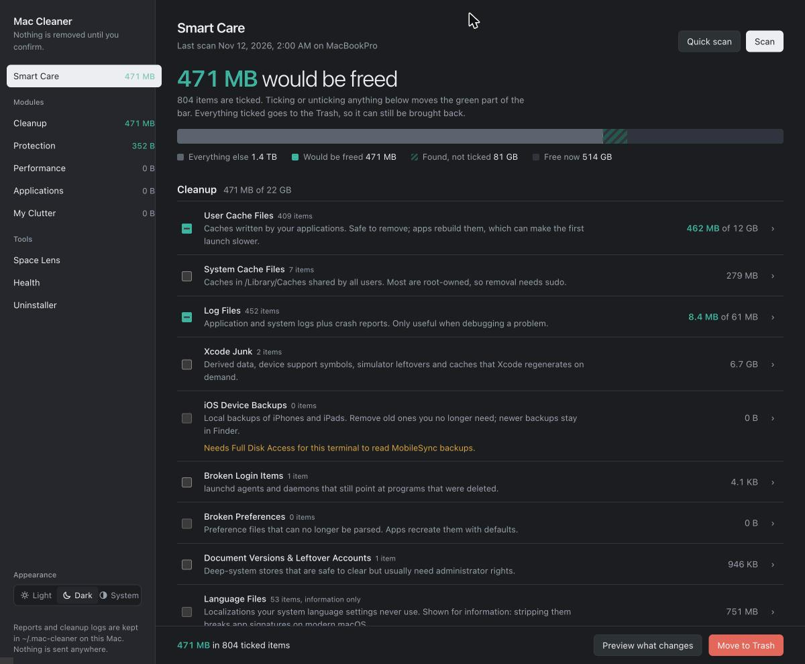

# mac-cleaner

An open, scriptable CleanMyMac-style cleaner for macOS. It scans the same
places CleanMyMac 5 does, shows what it found with sizes, and removes only
what you confirm. No helper daemon, no kernel extension, no account, no
network.

- **CLI**: `mac-cleaner scan | list | clean | uninstall | perf | health | space`
- **Web UI**: `mac-cleaner serve --open` on `http://127.0.0.1:4747`
- **MCP server + Claude Code skill**: lets Claude run scans and propose cleanups
- TypeScript on Node 22, ESM, hono. Reports live in `~/.mac-cleaner`, never in the repo.





The storage strip at the top draws the startup disk to scale; the green part
is exactly what the ticked items would free. Appearance (light, dark or
match the system) is switched at the bottom of the sidebar and remembered in
`~/.mac-cleaner/settings.json`.

## Download the app

Grab **MacCleaner-arm64.dmg** from the
[latest release](https://github.com/theIshwarSingh/mac-cleaner/releases/latest)
(direct link:
[MacCleaner-arm64.dmg](https://github.com/theIshwarSingh/mac-cleaner/releases/latest/download/MacCleaner-arm64.dmg)),
open it and drag Mac Cleaner to Applications. A `.pkg` installer and
`SHA256SUMS.txt` are attached to every release too. Builds are for Apple
silicon (arm64); on an Intel Mac, build from source with `npm run app`.

The app is ad-hoc signed, not notarized, so the first launch says macOS
cannot verify the developer. Open System Settings → Privacy & Security and
click **Open Anyway**, or run:

```bash
xattr -d com.apple.quarantine "/Applications/Mac Cleaner.app"
```

Releases are built by GitHub Actions (`.github/workflows/release.yml`) on a
macOS runner whenever a `v*` tag is pushed:

```bash
npm version patch            # bumps package.json and creates the tag
git push --follow-tags       # the workflow builds and publishes the release
```

## Quick start

```bash
npm install
npx tsx src/cli.ts scan --fast          # ~1 min; skips duplicate hashing and orphan lookups
npx tsx src/cli.ts list                 # groups with sizes
npx tsx src/cli.ts list --group logs    # items, with ids
npx tsx src/cli.ts clean --groups user-caches,logs        # dry run
npx tsx src/cli.ts clean --groups user-caches,logs --yes  # move to Trash
npx tsx src/cli.ts serve --open         # web UI
```

`npm run build` compiles to `dist/`, after which `node dist/cli.js` (or the
`mac-cleaner` bin) works without tsx.

## What it scans

| Module | Groups |
| --- | --- |
| Cleanup | user caches (incl. sandbox containers, Electron caches, hard-coded app caches), system caches, logs and crash reports, Xcode junk, iOS backups, broken login items, broken preferences, document versions, language files*, universal binaries*, Mail attachments, Trash bins |
| Protection | Safari / Chrome / Firefox history, cookies, autofill, sessions, caches; recent-items lists; application permissions (TCC)* |
| Performance | maintenance tasks (flush DNS, free RAM, thin snapshots, periodic scripts, reindex Spotlight, speed up Mail, repair permissions, rebuild Launch Services); login items and launchd agents/daemons |
| Applications | leftovers of uninstalled apps, unused DMG/PKG installers, unused apps*, pending macOS updates*; `uninstall <app>` removes a bundle with its support files, caches, preferences, containers and launch agents |
| My Clutter | large & old files, duplicates (size, head hash, full hash), Downloads grouped by origin |

`*` report-only: shown for information, never removed by this tool.

Pre-selection follows CleanMyMac's defaults: caches, logs, Xcode junk and
broken items are ticked; anything that is a judgment call (downloads,
large files, leftovers, developer package caches, browser history) is not.

## Safety model

- `clean`, `uninstall` and `perf run` are dry runs until `--yes` (or `confirm: true` over MCP / the web UI's Confirm button).
- Default removal is move-to-Trash (same-volume rename, Finder for other volumes). `--permanent` deletes. Trash bins and browser databases are always permanent.
- A fixed deny-list refuses to remove `/`, `/System`, `~`, `~/Library`, `~/Documents` and other roots even if a finding pointed there.
- Root-owned items are never touched silently: the CLI prints the `sudo rm -rf` command, or runs it through `sudo` only with `--sudo` in an interactive terminal. The MCP server and web UI never use sudo.
- Full Disk Access: Mail, Safari, TCC and iOS backups are unreadable without it. The scan says so per group instead of pretending they are empty. Grant it to your terminal app in System Settings > Privacy & Security if you want those groups.
- Every real cleanup writes a JSON log to `~/.mac-cleaner/logs/`.

## Mac app and installer

`npm run app` builds a native `Mac Cleaner.app` into `build/`, plus
`MacCleaner-<version>-<arch>.dmg` and `MacCleaner-<version>-<arch>.pkg`. The app is an
AppKit window (Swift, `app/Sources/main.swift`) showing the same interface
through WKWebView; the server ships inside it as a single Node executable, so
nothing else needs to be installed. Grant the app Full Disk Access (its menu
has a shortcut) to unlock the Mail, Safari, iOS backup and permissions groups.

The build is ad-hoc signed and not notarized. On another Mac, right-click the
app and choose Open the first time, or install from the .pkg.

## Claude Code

The repo is a Claude Code plugin: `skills/mac-cleaner/SKILL.md` teaches the
workflow and `.mcp.json` registers the MCP server (`scan`, `findings`,
`clean`, `apps`, `uninstall`, `health`, `space_lens`, `maintenance`). Add it
with `claude plugin add <path to this folder>` or run the server directly:

```bash
npx tsx src/mcp.ts
```

## How it was built

The feature set, module names, group names and the knowledge base of
protected paths were derived with REA (reverse-engineering engine) from the
installed `CleanMyMac_5.app` 5.3.1: its framework inventory
(`SystemJunkScanning`, `MailJunkScanning`, `TrashJunkScanning`,
`PrivacyScanning`, `PerformanceScanning`, `UninstallerScanning`,
`UnusedDiskImagesScanning`, `UpdaterScanning`, `OrganizeScanning`,
`DownloadsScanning`, `SpaceLensScanning`, `CleaningCore`) and the scan
identifiers and literal paths in those binaries (REA Evidence
`ev_bc490758…` lists the 41 `CMSystemJunkScanIdentifier*` strings and
`ev_80541114…` the hard-coded cache paths in `SystemJunkScanning`,
SHA-256 `05dbb36d…`). CleanMyMac's own rules ship
encrypted (`info.cmmkb`), so `src/core/kb.ts` is an independent, plain
TypeScript list built from those observations plus documented macOS
locations. No code or assets from CleanMyMac are included. Malware scanning,
real-time protection and the privileged helper are deliberately out of scope.

## Layout

```
src/core        types, knowledge base, remover (Trash / delete / sudo), utils
src/scanners    one file per CleanMyMac module
src/scan.ts     module registry, report save/load/merge, selection, formatting
src/cli.ts      command-line interface
src/server.ts   hono JSON API + web UI (ui/index.html)
src/mcp.ts      MCP server (stdio)
skills/         Claude Code skill
```
